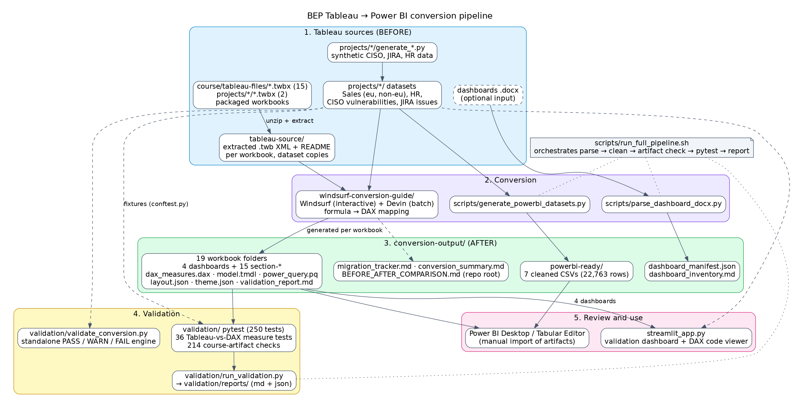

# BEP Tableau → Power BI Migration

Tableau workbooks, their datasets, and the Power BI artifacts converted from them (DAX measures, TMDL models, Power Query M, layouts and themes), with scripts that clean the data and a validation suite and Streamlit dashboard that prove each Tableau formula and its DAX conversion return the same results.



- **[Architecture](docs/architecture.md)** — how sources, conversion, outputs and validation fit together. Diagram source: [`docs/diagrams/conversion-pipeline.dot`](docs/diagrams/conversion-pipeline.dot) ([SVG](docs/diagrams/conversion-pipeline.svg)); re-render with `bash docs/diagrams/render.sh`.
- **[Usage guide](USAGE.md)** — commands, repository layout, and how to load the artifacts into Power BI.

## Quick start

```bash
pip install -r requirements.txt
bash scripts/run_full_pipeline.sh      # clean datasets, run 250 validation tests, write validation/reports/
streamlit run streamlit_app.py         # validation dashboard on http://localhost:8501
```

## What's in the repo

| Path | Contents |
|------|----------|
| [`conversion-output/`](conversion-output/) | Power BI artifacts for 19 workbooks: 4 dashboards (Sales, HR, CISO, IT PM) and 15 course sections (`section-*`), plus `powerbi-ready/` cleaned CSVs and the [migration tracker](conversion-output/migration_tracker.md) |
| [`tableau-source/`](tableau-source/) | Extracted `.twb` XML and a field inventory README for each source workbook |
| [`validation/`](validation/) | pytest suite, standalone validation engine and report generator |
| [`scripts/`](scripts/) | `.docx` dashboard parser, dataset cleaner and the full pipeline runner |
| [`streamlit_app.py`](streamlit_app.py) | Interactive validation dashboard and DAX code viewer |
| [`windsurf-conversion-guide/`](windsurf-conversion-guide/) | Conversion guides for Windsurf (interactive) and Devin (batch) |
| [`BEFORE_AFTER_COMPARISON.md`](BEFORE_AFTER_COMPARISON.md) | Every Tableau calculated field next to its DAX conversion |
| [`projects/`](projects/) | Source dashboards and datasets: Sales, HR, CISO cybersecurity, IT project management |
| [`course/`](course/) | Upstream Tableau course workbooks (`.twbx`), datasets and PDF notes |

## Credits

The course workbooks, course datasets and the Sales and HR projects come from [Data With Baraa's Tableau Ultimate Course](https://youtu.be/K3pXnbniUcM) (this repo is a fork of [DataWithBaraa/tableau-ultimate-course](https://github.com/DataWithBaraa/tableau-ultimate-course)) by Baraa Khatib Salkini. Credit "Data With Baraa" when sharing that material.

## License

[MIT](LICENSE).
