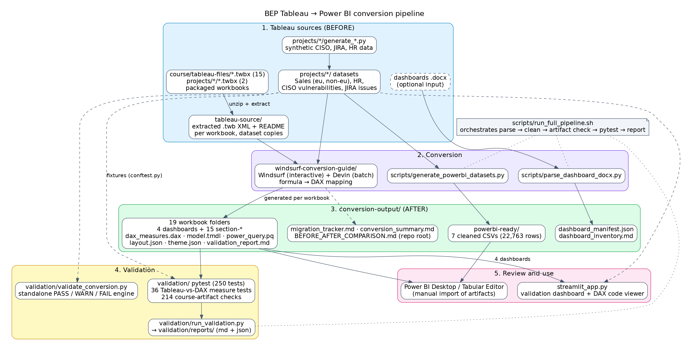

# Architecture — Tableau → Power BI Conversion Pipeline

This repository holds Tableau workbooks and their datasets, the Power BI artifacts converted from them, and the tools that clean the data and check the conversions. Nothing here talks to Tableau Server or the Power BI Service: every step runs locally on CSV, XML and text files.

The diagram source is [`diagrams/conversion-pipeline.dot`](diagrams/conversion-pipeline.dot) (Graphviz). After editing it, run `bash docs/diagrams/render.sh` to regenerate [`conversion-pipeline.png`](diagrams/conversion-pipeline.png) and [`conversion-pipeline.svg`](diagrams/conversion-pipeline.svg) (needs `graphviz`).

## 1. Tableau sources (before)

| Path | What it holds |
|------|---------------|
| `course/tableau-files/*.twbx` | 15 packaged course workbooks (Sections 05–15) from the upstream Data With Baraa Tableau course |
| `course/datasets/`, `course/docs/` | Course datasets (EU and non-EU, small and big) and PDF course notes / cheat sheets |
| `projects/sales-dashboard-project/` | `Sales & Customer Dashboards.twbx`, Orders/Customers/Products/Location CSVs (`datasets/eu`, `datasets/non-eu`), mockups |
| `projects/hr-dashboard-project/` | `HR Dashboard.twbx`, `dataset.csv` (8,950 employees), `generate_data.py`, `mockups.drawio` |
| `projects/ciso-cybersecurity-project/` | `vulnerabilities.csv` (200 rows) generated by `generate_vuln_data.py` — no Tableau workbook |
| `projects/it-project-mgmt-project/` | `jira_issues.csv` (300 rows) generated by `generate_jira_data.py` — no Tableau workbook |
| `tableau-source/` | The "before" side used for conversion: each workbook's `.twb` XML extracted from its `.twbx` (`<Workbook>/extracted/*.twb`), a README inventorying its calculated fields, parameters, data sources and worksheets, plus copies of the course and Sales datasets |

The CISO and IT project-management dashboards have no source workbook; they are defined by `scripts/parse_dashboard_docx.py`'s built-in definitions and the guides in `windsurf-conversion-guide/`.

## 2. Conversion

Formula conversion (Tableau calculated fields, LOD expressions, table calculations and parameters → DAX; data sources → Power Query M and a TMDL star schema; dashboards → layout and theme JSON) is not a script in this repo. It was done by AI-assisted sessions following the guides in `windsurf-conversion-guide/`:

- `CONVERSION_OUTLINE.md` — phase-by-phase Windsurf workflow and the Tableau → DAX mapping reference.
- `DEVIN_BATCH_WORKFLOW.md` — how Devin runs the same conversion in batch (manifest-driven, one PR per batch).
- `CISO_CYBERSECURITY_CONVERSION.md`, `IT_PROJECT_MGMT_CONVERSION.md` — per-dashboard designs, including the Tenable.io and JIRA API connector templates (`output/api_connector_mapping.md`).

Two scripts prepare the inputs and metadata around that conversion:

- `scripts/parse_dashboard_docx.py [file.docx] --output-dir conversion-output` reads a Word document listing dashboards and writes `dashboard_manifest.json` and `dashboard_inventory.md`. Without a document it writes the 4 built-in dashboard definitions (Sales, HR, CISO, IT PM).
- `scripts/generate_powerbi_datasets.py --output-dir conversion-output/powerbi-ready` turns the 7 source CSVs under `projects/` into comma-delimited UTF-8 files with ISO `YYYY-MM-DD` dates and trimmed columns.

## 3. Conversion output (after)

`conversion-output/` has one folder per converted workbook — 19 in total:

- 4 dashboards: `sales-dashboard/`, `hr-dashboard/`, `ciso-cybersecurity-dashboard/`, `it-project-mgmt-dashboard/`
- 15 course workbooks: `section-05-data-sources/` … `section-15-sales-customer-dashboards/`

Each folder contains the same six files:

| File | Contents |
|------|----------|
| `dax_measures.dax` | DAX measures, each preceded by its original Tableau formula as a comment |
| `model.tmdl` | Tabular model (tables, columns, relationships) |
| `power_query.pq` | Power Query M import script |
| `layout.json` | Page and visual layout specification |
| `theme.json` | Power BI report theme |
| `validation_report.md` | Per-measure conversion and validation notes |

Alongside them: `powerbi-ready/` (7 cleaned CSVs, 22,763 rows), `dashboard_manifest.json` / `dashboard_inventory.md`, `migration_tracker.md` (status of all 17 Tableau workbooks), and `conversion_summary.md`. `BEFORE_AFTER_COMPARISON.md` at the repo root lists every calculated field side by side with its DAX conversion.

## 4. Validation

`validation/` is a pytest suite (250 tests) plus two runners:

| File | Checks |
|------|--------|
| `conftest.py` | Loads the source CSVs from `projects/` as fixtures (semicolon delimiters, day-first dates) |
| `test_sales_dashboard.py`, `test_hr_dashboard.py`, `test_ciso_dashboard.py`, `test_it_project_mgmt.py` | 36 tests: compute each Tableau formula and its DAX conversion in pandas on the same data and compare the results |
| `test_course_workbooks.py` | 214 tests: every `section-*` folder has all six artifacts, non-empty, with valid JSON and a TMDL model declaration; `BEFORE_AFTER_COMPARISON.md` exists with content and `migration_tracker.md` covers all workbooks |
| `validate_conversion.py` | Standalone engine for the 4 dashboards: PASS (±0.001), WARN (±0.01) or FAIL per measure, printed to the console |
| `run_validation.py` | Runs pytest and writes `validation/reports/conversion_validation_report.md` and `validation_summary.json` |

`validation/reports/` is generated on each run and is not committed.

## 5. Review and use

- `streamlit_app.py` is a local dashboard (`streamlit run streamlit_app.py`) that re-runs the Tableau-vs-DAX checks (pandas re-implementations of both formulas) for the 4 dashboards against `projects/` data and shows them as KPI cards, charts and expandable formula comparisons. Its **DAX Code Viewer** page shows the DAX, TMDL, Power Query, layout and theme files of those 4 dashboards from `conversion-output/`; the 15 `section-*` conversions are not listed there.
- The artifacts are imported into Power BI Desktop (or Tabular Editor for TMDL) by hand; [USAGE.md](../USAGE.md#how-to-use-the-power-bi-artifacts) has the steps.

## Orchestration

`scripts/run_full_pipeline.sh [file.docx]` runs, in order: install `requirements.txt` and `validation/requirements.txt`; parse the document (or keep an existing manifest, or write the defaults); regenerate `powerbi-ready/`; check that the 4 dashboard folders have all six artifacts; run `pytest validation/`; run `run_validation.py` to write the reports; print a summary. It does not perform conversion itself.
